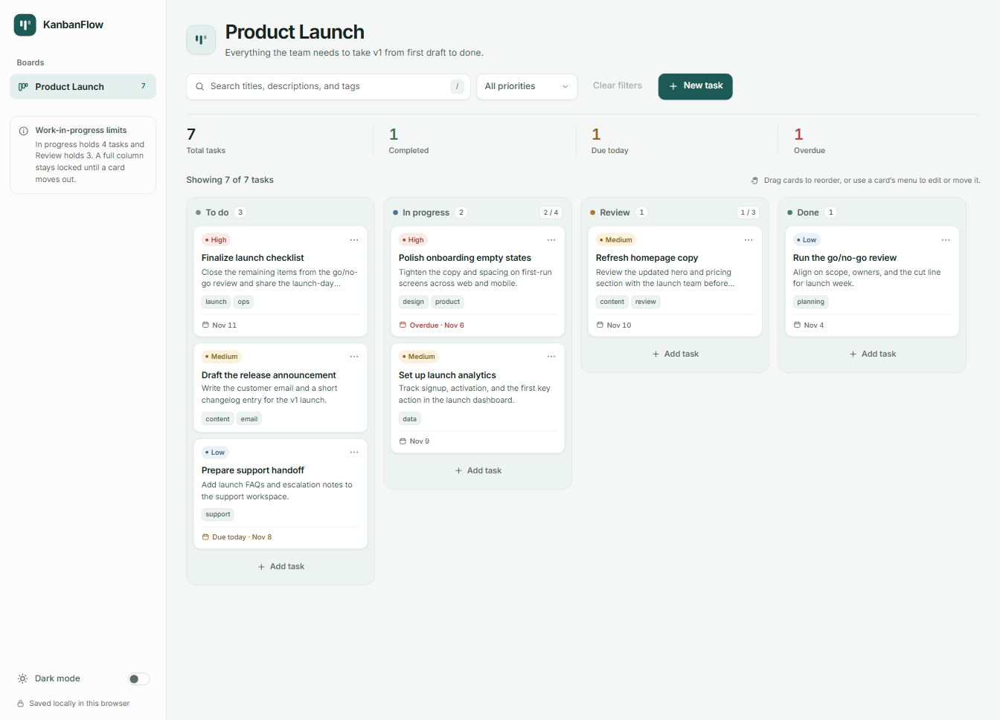

# KanbanFlow

A calm, local-first Kanban board for moving work from first draft to done. KanbanFlow is a small, production-quality static web app built with semantic HTML, CSS, and vanilla JavaScript — no frameworks, build step, or backend.

**Live demo:** [https://kanbanflow.kevinandy.mg](https://kanbanflow.kevinandy.mg)



## Features

- **Four-column workflow** — To do, In progress, Review, and Done, each with a colour dot and live task count.
- **Work-in-progress limits** — In progress holds 4 tasks and Review holds 3. Full columns warn you and reject new cards until work moves out.
- **Full task management** — Create, edit, move, and delete tasks. Deletion requires confirmation.
- **Drag and drop** — Move cards between columns or reorder them within a column on desktop. Task order is stored exactly and restored after reload. On touch screens, use a card's menu to edit it and choose another column.
- **Task details** — Title (required, 100 characters), description (500 characters), priority, optional due date, up to four tags, and destination column.
- **Useful cards** — Priority colours, a two-line description preview, tag pills, due dates, and red overdue dates outside the Done column.
- **Search and priority filtering** — Search titles, descriptions, and tags, filter by priority, and clear both at once. Result counts update as you type.
- **Board statistics** — Total tasks, completed tasks, tasks due today, and overdue tasks update automatically.
- **Light and dark themes** — A restrained mineral palette in both modes. Your theme choice persists.
- **Responsive layout** — A fixed sidebar on desktop, an off-canvas drawer on mobile, and horizontally scrolling fixed-width columns at every size.
- **Built for keyboard and screen-reader use** — Native dialog focus handling, visible focus states, accessible menus, labelled controls, live announcements, and reduced-motion support.
- **No setup** — Everything runs from static files and saves to `localStorage`.

The first visit includes a small sample Product Launch board so the layout and features are easy to explore. Every sample card is a regular task: edit or delete it freely.

## Tech stack

- Semantic HTML5
- CSS custom properties, Flexbox, Grid, and responsive media queries
- Vanilla JavaScript (ES6+)
- Browser `localStorage` for persistence
- [Inter](https://fonts.google.com/specimen/Inter) from Google Fonts

There are no JavaScript libraries, CSS frameworks, package managers, build tools, servers, API keys, analytics, or external assets beyond the font.

## Run locally

Because the app uses relative paths throughout, you can open it directly:

```text
Open index.html in a modern browser.
```

For the closest experience to GitHub Pages, serve the folder over HTTP:

```bash
# From the project folder
python3 -m http.server 8000
```

Then open [http://localhost:8000](http://localhost:8000). Any static file server works; no install or build command is required.

## Project structure

```text
kanbanflow/
├── index.html      # App shell, board markup, dialogs, and accessible UI
├── style.css       # Design tokens, layout, themes, responsive and 404 styles
├── app.js          # State, rendering, CRUD, drag and drop, filters, storage
├── 404.html        # Custom GitHub Pages not-found page
├── CNAME           # Custom domain for GitHub Pages
├── screenshot.png  # README preview image
└── README.md
```

The favicon is an inline SVG data URI in the head of `index.html` and `404.html`, so no separate icon file is needed.

## Data and browser storage

KanbanFlow has no account, server, or database. Everything stays in the browser on the device you use.

| Key | Contents |
| --- | --- |
| `kanbanflow_tasks_v1` | The complete task array, including each task's column and order. |
| `kanbanflow_theme` | Your selected `light` or `dark` theme. |

A task is stored in this shape:

```json
{
  "id": "unique-id",
  "title": "Task title",
  "description": "Task description",
  "priority": "low | medium | high",
  "dueDate": "YYYY-MM-DD or empty string",
  "tags": ["tag1", "tag2"],
  "columnId": "todo | in-progress | review | done",
  "order": 0,
  "createdAt": 123456789
}
```

Task IDs are generated with `crypto.randomUUID()`. Task text is rendered with DOM text nodes rather than unescaped HTML.

Because storage is local to the browser and site origin:

- Clearing site data, using private browsing, or changing the site origin will hide or remove the board.
- The same board does not sync between browsers or devices.
- If browser storage is unavailable, the app still works for the current session and shows a warning that changes will not survive a reload.
- There is no cloud backup; export/import is a possible future addition.

## Accessibility

- All controls are keyboard reachable and use visible focus rings.
- The task dialog is a native `<dialog>` with a focus trap, labelled fields, inline validation, and Escape/backdrop/Cancel/X closing.
- Closing a dialog returns focus to the control that opened it. After saving, focus moves to the saved card's options button.
- The card menu supports arrow keys, Home, End, Escape, and Tab.
- Card actions are available from the menu; moving a task is also possible from the edit dialog, so drag and drop is not the only way to change columns.
- Status changes and results are announced through polite live regions.
- `prefers-reduced-motion` is respected.

## GitHub Pages deployment

1. Push these files to the root of a GitHub repository.
2. In the repository, open **Settings → Pages**.
3. Under **Build and deployment**, choose **Deploy from a branch**.
4. Select the main branch and the `/ (root)` folder, then save.
5. The `CNAME` file points GitHub Pages at `kanbanflow.kevinandy.mg`. Configure that custom domain in your DNS provider as GitHub Pages requires, and enable **Enforce HTTPS** when it becomes available.

`404.html` is picked up automatically by GitHub Pages for missing paths. No Actions workflow or build output folder is needed.

## Roadmap

These are ideas, not shipped features:

- Export and import a board as JSON for backup or transfer.
- Optional labels with custom colours.
- Keyboard-driven card reordering.
- Cross-tab synchronisation for two windows on the same device.
- Multiple boards with a board switcher.
- Configurable WIP limits per column.

## License

Copyright © 2026 Kevin Andy. All rights reserved. This project is not licensed for reuse, modification, redistribution, or commercial use.
